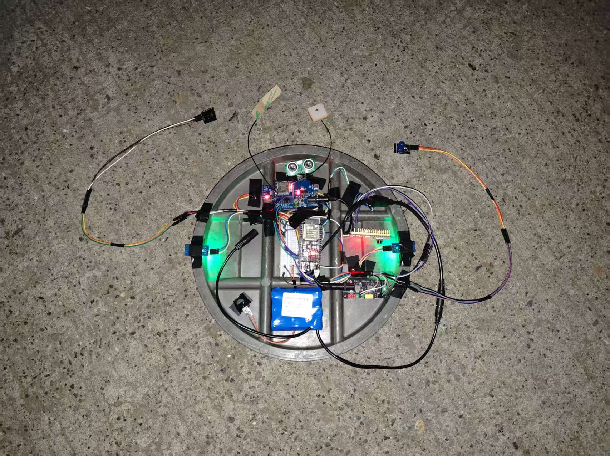
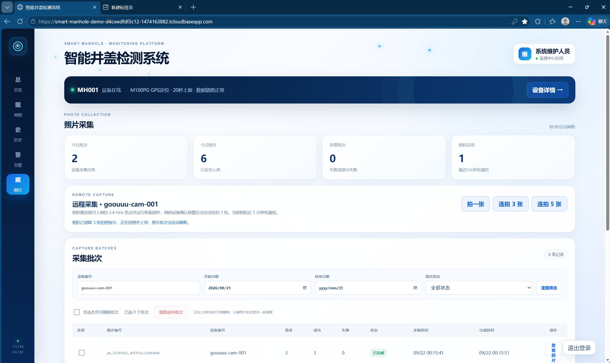
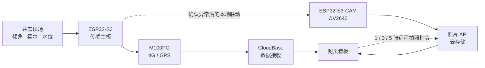

<div align="center">

# 🕳️ 智能井盖监测系统

### 让井盖状态看得见，让异常处置更及时

**双 ESP32-S3 协作 · 多传感器监测 · 4G/GPS 上报 · 云端看板 · 联动拍照**


[查看硬件实物与接线](output/docx/智能井盖监测系统-硬件设计说明-可提交版.docx) · [查看网页界面说明](output/docx/智能井盖监测系统-网页界面展示与操作说明.docx) · [查看答辩 PPT](output/ppt/智能井盖监测系统-23页原版文字图形可编辑版-v6.pptx)

</div>

> 一块板负责“感知与报警”，另一块板负责“拍照取证”。传感数据经 4G 上传，照片经可联网的 2.4 GHz Wi-Fi 上传，最终在同一个网页查看。

### 实物原型

<p align="center"></p>

<p align="center"><sub>原型整体展示：照片中的器件摆放用于功能演示，正式安装还需考虑固定与防护。</sub></p>

## ✨ 一分钟了解项目

井盖松动、移位和积水往往不容易及时发现。本项目把现场监测、声光提示、远程上报和照片采集合成一条可演示的链路：

| 现场感知 | 风险判断 | 远程联动 | 可视化管理 |
|---|---|---|---|
| MPU6050 倾角、双侧霍尔、US-100 水面距离 | 持续确认、分级提示，减少短时抖动误报 | M100PG 4G/GPS 上报；ESP32-S3-CAM 接收拍照指令 | 总览、地图、历史、告警、照片批次 |

### 网页实拍



<sub>截图取自项目运行时的网页；其中的在线状态、坐标、时间和数量仅代表截图当时，不是实时数据。</sub>

## 🧩 系统怎样协作



两块板分别烧录、分别运行：传感主板负责倾角、水位、霍尔和现场声光；相机板负责拍照、联网与上传。两者可通过单向串口线和公共 GND 做本地告警联动。相机上传照片仍需连接能访问互联网的 Wi-Fi 热点。

## 🔍 核心功能

| 模块 | 主要能力 |
|---|---|
| 🧭 倾角监测 | MPU6050 追踪井盖姿态；倾角异常持续约 10 秒后触发声光，恢复与维修复位有独立保护逻辑。 |
| 🧲 在位检测 | 左右两侧霍尔分别判断磁铁是否在位；双侧离位持续 10 秒才启动对应现场告警，单侧离位可作为状态上报。 |
| 🌊 水位提示 | US-100 测探头到水面的距离：大于 30 cm 安全、20–30 cm 低级、10–20 cm 中级、小于 10 cm 紧急。 |
| 📡 4G 与定位 | 传感主板通过 M100PG 上报状态；网页可查看设备位置、历史记录与告警时间线。 |
| 📷 照片取证 | 相机支持网页远程拍 1 张、连拍 3 张或 5 张；按批次上传、预览，并可选择删除云端记录。 |
| 🔔 异常联动 | 传感主板到相机板有本地串口触发，照片 API 支持云端拍照指令；具体触发数量和部署条件见各模块说明。 |

> 这是实物验证原型。现场安装阈值、供电、防水、网络稳定性和长期可靠性仍需结合实际井盖环境测试，不能直接当作市政安全设备投用。

## 🗂️ 仓库导航

| 路径 | 内容 |
|---|---|
| [`src/`](src/) + [`platformio.ini`](platformio.ini) | 传感主板固件及 PlatformIO 配置 |
| [`camera/`](camera/) | ESP32-S3-CAM 拍照、热点连接与照片上传 |
| [`web/`](web/) | 网页看板源码 |
| [`cloudbase/`](cloudbase/) | 设备上报、网页接口和照片 API |
| [`mpu6050_tilt_switch/`](mpu6050_tilt_switch/) | 倾角与传感器接线、阈值、现场调试说明 |
| [`output/`](output/) | Word、PDF、答辩 PPT 等交付材料 |

## 🚀 从哪里开始

1. **先看实物与接线**：打开[硬件设计说明](output/docx/智能井盖监测系统-硬件设计说明-可提交版.docx)，再对照[传感器接线说明](mpu6050_tilt_switch/README.md)。
2. **分别准备两块板**：传感主板使用根目录 PlatformIO 工程；相机板使用 [`camera/README.md`](camera/README.md) 中的配置、烧录与热点测试步骤。烧录前务必确认串口对应哪块板；根目录配置中的 `COM8` 是旧环境端口，不能直接照搬。
3. **配置网页和云端**：网页环境变量参考 [`web/.env.example`](web/.env.example)；设备上报和照片接口分别查看 [`device-ingest`](cloudbase/functions/device-ingest/README.md) 与 [`photo-api`](cloudbase/functions/photo-api/README.md)。
4. **按界面演示**：通过[网页界面展示与操作说明](output/docx/智能井盖监测系统-网页界面展示与操作说明.docx)查看总览、地图、历史/告警、远程拍照与照片管理的操作位置。

只想在本地启动网页界面时，先完成 `.env.example` 所示配置，再在 `web/` 目录运行：

```bash
npm ci
npm run dev
```

网页项目要求 Node.js 22.13 或更新版本。仅启动前端不等于设备已联网；真实数据与照片还需要云函数、设备令牌、热点和硬件链路正常工作。

## 🔗 常用网页、API 与相机 IP

| 用途 | 地址 | 说明 |
|---|---|---|
| 🌐 智能井盖网页 | [打开演示网站](https://smart-manhole-demo-d4cxwdfdf3c12-1474163882.tcloudbaseapp.com/) | 部署网页入口；部分功能需要登录，地址以实际部署为准。 |
| 📡 传感数据上报 | `https://smart-manhole-demo-d4cxwdfdf3c12.service.tcloudbase.com/api/v1/device/telemetry` | 供设备发起 POST 请求，不是供浏览器直接查看的页面。 |
| 📷 照片 API | `https://smart-manhole-demo-d4cxwdfdf3c12.service.tcloudbase.com/photo-api` | 相机和网页调用的接口入口；访问需要相应身份凭证。 |
| 📱 相机连接热点后的本地网页 | `http://<相机当前热点IP>/` | 电脑或手机需与相机处于可互访的同一局域网。 |
| 🛟 相机备用 AP 页面 | `http://192.168.4.1/` | 仅在连接相机的 `ESP32-S3-CAM-SETUP` Wi-Fi 后使用；该 AP 本身不提供云端网络。 |

`http://10.63.211.122/` 是此前一次热点分配的**历史示例**，不是永久地址。换手机热点、切换网络或重新分配 DHCP 后，先看相机 115200 波特率串口日志中的 `[wifi] open http://x.x.x.x/`；新版固件每约 15 秒会重复打印。也可从相机本地 `/status` 接口查看 `hotspotIp`。烧录与监视所用 COM 口同样应按当前电脑识别结果确认。

### 密钥与配置放在哪里？

| 配置项 | 正确位置 |
|---|---|
| 热点名称与密码 | 从 [`camera/include/secrets.example.h`](camera/include/secrets.example.h) 复制为本地 `camera/include/secrets.h` 后填写。 |
| 相机设备令牌 | 按 [`camera/README.md`](camera/README.md) 运行 `provision_token.py`，写入被 Git 忽略的本地配置。 |
| 网页环境 ID、地图浏览器 Key、照片 API 地址 | 参考 [`web/.env.example`](web/.env.example)，配置在本地 `web/.env.local`；浏览器 Key 应在提供方控制台限制可用域名。 |
| CloudBase 服务端 API Key、设备令牌映射 | 配置在云函数环境变量中；名称及用途见 [`photo-api/README.md`](cloudbase/functions/photo-api/README.md)。 |

**README 只写配置方式，不公开真实密钥、设备令牌或热点密码。**这些值一旦提交到 Git 历史，后续删除 README 也不能保证已泄露的凭证失效；如曾意外提交，应立即在对应平台轮换。

## 📚 交付材料

| 文件 | 适合查看什么 |
|---|---|
| [硬件设计说明 · Word](output/docx/智能井盖监测系统-硬件设计说明-可提交版.docx) | 实物图、硬件模块及接线 |
| [网页界面展示与操作说明 · Word](output/docx/智能井盖监测系统-网页界面展示与操作说明.docx) | 六页实际网页截图与界面介绍 |
| [应用方案提交书 · PDF](output/pdf/智能井盖检测系统-应用方案提交书.pdf) | 方案与应用场景 |
| [科技视觉答辩稿 · PPTX](output/ppt/智能井盖监测系统-23页科技视觉答辩稿.pptx) | 视觉展示版 |
| [文字图形可编辑答辩稿 · PPTX](output/ppt/智能井盖监测系统-23页原版文字图形可编辑版-v6.pptx) | 便于继续修改的版本 |

## 🔐 配置与安全提示

- Wi-Fi 密码、设备令牌、云端密钥和本地环境变量不应提交到 Git；请从仓库中的示例配置创建本地文件。
- 相机的局域网 IP 由当前热点分配，换网络后可能变化；公网网页操作依赖云端 API，而不是固定的相机局域网 IP。
- 拍照批次和单张照片的删除会清理云端存储及记录，操作前请确认是否需要保留取证材料。
- 首次烧录、接线和供电请以对应板卡的详细说明为准，不要把两块 ESP32-S3 混作同一烧录目标。

---

<div align="center">

**从一块井盖出发，把“发现异常 → 现场提醒 → 远程知晓 → 图片留证”串成闭环。**

</div>
